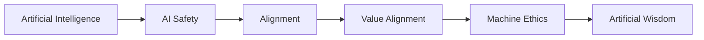

# Hi, I'm Madhusudhan Pathak (Myspy) 👋
**An AI Safety Researcher, focused in Machine Ethics - Artificial Wisdom**

 

---

## About me

Hey, I'm Madhusudhan — an AI Safety researcher currently looking for a PhD. I spend most of my time somewhere along this chain, moving back and forth between the pieces rather than sitting still at one:

A lot of alignment work asks *how* do we get a system to do what we want. Machine ethics pushes a step further and asks how to make machines understand what we want, specially our value system. I'm drawn to the question past that one: once a system can weigh competing values at all, what does it take for it to weigh them *wisely*, not just safely, not just correctly, but wisely? That's the thread running through most of what I read, write and think about.

A few honest things about where I'm at:

- 🔭 Right now I'm deep in value alignment and machine ethics, with one eye on what I think comes after, something closer to artificial wisdom
- 🌱 I'm mostly in learning mode: poking at today's alignment approaches to see where they actually hold up and where they quietly don't
- ✍️ I think out loud in public — longer articles on [Substack](https://madhusudhanpathak.substack.com/), looser conversations on [YouTube](https://youtube.com/@artificially.conscious)
- 💞️ Always happy to talk to people working on AI safety, alignment or machine ethics, collaborators, skeptics, fellow travelers, all welcome. See "For Discussion" on my website.
- 📫 Easiest way to reach me is [LinkedIn](https://www.linkedin.com/in/MadMyspy/)

---

## How I work

Quick honesty check: I'm a researcher, not a developer. Most of the code you'll find in my repos is **vibe-coded**, I describe what I need to a model, it writes the thing, and I steer from there rather than hand-typing it myself.

So basically, I am mainly an AI Safety Researcher, who mostly vibe codes to make tools that support my day to day work and research. Working with LLMs closely as a researcher, and then also using them for such projects gives me in depth understanding and hands on experience. That turned out to teach me more than I expected. Sitting with a model for hours, trying to get it to actually build what I have in my head, gives you a different kind of intuition for prompt design, prompt engineering and agentic workflows (Claude Code skills included) than reading papers about alignment ever could. I've started thinking of my own tool-building as a small, running experiment: what does a model actually do when you hand it a goal and step back? That question, oddly enough, keeps finding its way back into how I think about alignment and value alignment at the research level too.

---
<!---
MadhusudhanPathak/MadhusudhanPathak is a ✨ special ✨ repository because its `README.md` (this file) appears on your GitHub profile.
You can click the Preview link to take a look at your changes.
--->
